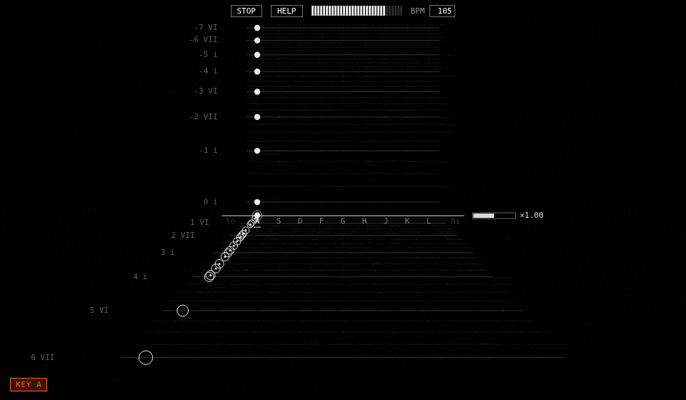
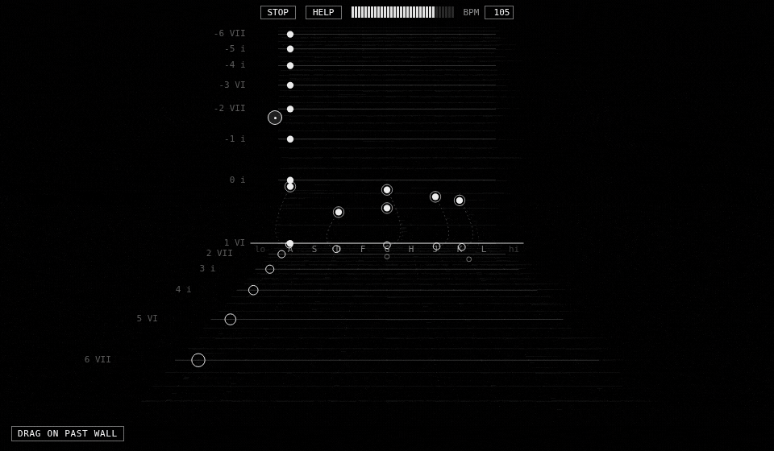
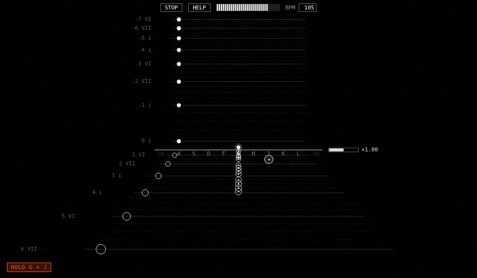
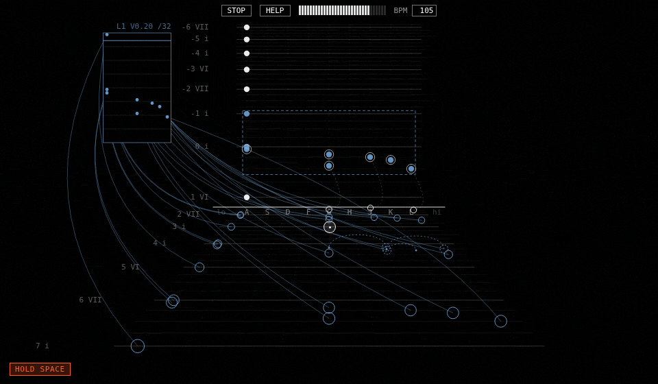

# ☄️ Orbital Strike DJ

A cybernetic handpan DJ interface built around a continuous time-tape: a vertical **past wall** above the `NOW` plane and a decelerating perspective **future floor** below it. Play live on the home row, lock past phrases into self-varying attention boxes, steer harmonic density in real time, and trigger quantized drops or stops from a single radial HUD.

[Try it live](https://chuanqisun.github.io/orbital-strike/)

## Interactions

### 1. Direct Play Notes

Tap home-row keys <kbd>A</kbd>–<kbd>L</kbd> to strike the 9-tone E Kurd handpan immediately. Played notes leave ringed marks on the past wall and project decaying **echoes** into the future tape. Click any empty cell on the future floor to schedule a note ahead of time, or right-click / right-drag to mute notes.



### 2. Marquee Selection & Attention Boxes

Drag across notes on the past wall to lock a phrase into a persistent **attention box** (`L1`, `L2`, …) in the side gutter (hold <kbd>Shift</kbd> to include already-grouped notes). Each box loops with its own playhead and projects parabola attention curves onto the future tape. Hover a box and scroll (or press <kbd>[</kbd> / <kbd>]</kbd>) to dial its **variation** (`V 0.00`–`1.00`)—introducing chord-tone substitutions, octave leaps, timing shifts, and pickup ornaments.



### 3. Hold Key & Scroll Wheel to Tune Density

Hold one or more keys (<kbd>A</kbd>–<kbd>L</kbd>) while playing to engage the chord-aware **hold planner**, which continuously populates the future tape with notes that fit the active `i–VI–VII–i` progression. While holding, scroll up or down to scale the density meter (`×0.25`–`×4.00`) next to the `NOW` line—expanding into dense rhythmic runs and harmonic doubles or thinning back to sparse accents.



### 4. Drop the Beat

Hold <kbd>Space</kbd> to open the radial **DROP / STOP HUD** centered on the pointer:

- Point **up** (`HALF`, `FULL`, or `FAKEOUT`) to enter **BUILD**—compressing recent notes into an accelerating loop-roll with rising high-pass filter and noise sweep.
- **Press and hold** the mouse button on a drop mode to **FREEZE & CHARGE** in a reverb-tail vacuum, then **release** to slam directly into the climax drop with generated hooks, sidechained sub/bass, and kick-driven visual shockwaves.
- Release <kbd>Space</kbd> while pointing up (without freezing) to arm a quantized drop on the next bar line, or release inside the center ring to cancel safely.



## Development

```bash
npm install
npm run dev
```

| Script            | Description                                    |
| ----------------- | ---------------------------------------------- |
| `npm run dev`     | Start Vite dev server                          |
| `npm run build`   | Type-check (`tsc`) and build production bundle |
| `npm run preview` | Preview production build locally               |

Append `?seed=<base36>` to the URL to reproduce deterministic variation sequences.
