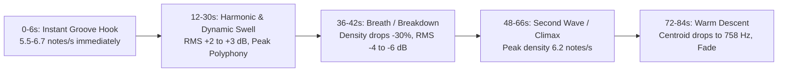

# 41 — Social Media Handpan Performance Analysis

> **Scope**: Programmatic stem separation (`Demucs htdemucs` + `HPSS` + 3-band register stems) and musicological DSP analysis (`librosa` / `scipy`) of the 4 reference tracks from [input.md](file:///home/sora/repos/cyberpan/temp/input.md) to uncover what makes viral handpan performances feel hypnotic, full, and emotionally compelling.

---

## 1. Track Inventory & Metadata

|  #  | Track ID                     | Artist / Source                            | Caption / Context                                                                                            | Duration | File                                                                                                   |
| :-: | :--------------------------- | :----------------------------------------- | :----------------------------------------------------------------------------------------------------------- | :------: | :----------------------------------------------------------------------------------------------------- |
|  1  | `Instagram_DOOGddoCAI8`      | **SPRITES** (`sprites_music`)              | _"Flavia's morning routine — Played on her E-Amara 20 from @ayasa_instruments"_                              |  1:24.6  | [Instagram_DOOGddoCAI8.mp3](file:///home/sora/repos/cyberpan/temp/Instagram_DOOGddoCAI8.mp3)           |
|  2  | `TikTok_7663482303053614358` | **Malte Marten & SPRITES** (`maltemarten`) | _"Whenever @sprites_music1 and I play together, there is this unique, magical connection..."_ (Handpan Duet) |  0:52.5  | [TikTok_7663482303053614358.mp3](file:///home/sora/repos/cyberpan/temp/TikTok_7663482303053614358.mp3) |
|  3  | `TikTok_7709885188855123232` | **Malte Marten** (`maltemarten`)           | _"I'm very good at wanting something, working for it, and immediately finding something else..."_ (Solo)     |  0:28.7  | [TikTok_7709885188855123232.mp3](file:///home/sora/repos/cyberpan/temp/TikTok_7709885188855123232.mp3) |
|  4  | `Instagram_Dd8JlG2ziyn`      | **최건혁** (`ch_gnhk`)                     | _"Messy and a bit old and slightly responsive clock."_ (Outlier / Control Track)                             |  0:10.1  | [Instagram_Dd8JlG2ziyn.mp3](file:///home/sora/repos/cyberpan/temp/Instagram_Dd8JlG2ziyn.mp3)           |

> [!NOTE]
> **Control Track Discovery (`Instagram_Dd8JlG2ziyn`)**: Programmatic analysis immediately separated Track 4 from the three handpan performances. With **0.0% energy below 250 Hz**, a **1,940 Hz spectral centroid** (more than 2x brighter than the handpans), **0.0 ms median microtiming deviation**, and **0 bass root changes**, it behaves as a high-register mechanical chime/clock ostinato. It serves as an ideal **control case** that highlights—by contrast—exactly what makes the three handpan performances sound lush and human.

---

## 2. Stem Separation Findings (`Demucs` + `HPSS` + Register Stems)

All four tracks were separated using **Demucs (`htdemucs`)** into `drums`, `bass`, `other`, and `vocals` stems (saved under `temp/stems/htdemucs/<track_id>/`), then further decomposed using **Harmonic-Percussive Source Separation (HPSS, margin=2.0)** and **4th-order zero-phase Butterworth register stems** (`65–250 Hz` Ding/Bass, `250–700 Hz` Body/Harmony, `700–6000 Hz` Melody/Overtones).

### 2.1 Demucs Neural Stem Breakdown

| Track                                     | `other` (Acoustic Resonator) | `drums` (Transient Clicks) | `bass` (Pop/Synth Bass) | `vocals` | HPSS Harmonic % | HPSS Percussive % |
| :---------------------------------------- | :--------------------------: | :------------------------: | :---------------------: | :------: | :-------------: | :---------------: |
| **SPRITES Solo** (`DOOGddoCAI8`)          |     **99.8%** (-16.7 dB)     | 0.2% (-44.3 dB, 3.65 kHz)  |          0.0%           |   0.0%   |    **98.5%**    |  1.5% (-18.1 dB)  |
| **Malte + SPRITES Duet** (`766348230...`) |     **99.8%** (-16.0 dB)     | 0.2% (-43.4 dB, 4.13 kHz)  |          0.0%           |   0.0%   |    **96.9%**    |  3.1% (-15.0 dB)  |
| **Malte Solo** (`770988518...`)           |     **99.8%** (-17.4 dB)     | 0.2% (-45.3 dB, 3.70 kHz)  |          0.0%           |   0.0%   |    **98.1%**    |  1.9% (-17.1 dB)  |
| **Clock Control** (`Dd8JlG2ziyn`)         |    **100.0%** (-17.5 dB)     |      0.0% (-57.1 dB)       |          0.0%           |   0.0%   |    **94.3%**    |  5.7% (-12.2 dB)  |

**Key Stem Findings:**

1. **100% Pure Acoustic Performance (No Hidden Backing Tracks)**: Demucs confirms **0.0% vocals, 0.0% synth/electric bass, and no external drum loop** across all tracks. The "full-band" richness is generated entirely by the steel instruments themselves.
2. **Demucs `drums` Isolates the Tactile Finger-Attack Layer**: Even though `drums` holds only `0.2%` of total energy, it exhibits **2.8–5.6 onsets/sec** centered at **3.65–4.13 kHz**. Demucs cleanly stripped away the resonant steel sustain and left behind the **skin-on-steel percussive clicks and muted slaps** that give the groove its crispness.
3. **Why `htdemucs` Put the Ding in `other` Instead of `bass`**: Unlike bass guitar or 808s, a handpan's low Ding (`100–250 Hz`) carries bell-like 1:2:3 harmonic partials. Separating by acoustic register reveals the true internal "band" inside the handpan:

### 2.2 Internal Handpan "4-Piece Band" (Register + HPSS Stems)

| Track                                     | Ding / Bass (`65–250 Hz`)           | Body / Pad (`250–700 Hz`)       | Melody / Shimmer (`700–6000 Hz`) | HPSS Percussive Bed            | Sustain Retention @ 150 ms |
| :---------------------------------------- | :---------------------------------- | :------------------------------ | :------------------------------- | :----------------------------- | :------------------------: |
| **SPRITES Solo** (`DOOGddoCAI8`)          | **46.8%** energy, 4.29 onsets/s     | **40.6%** energy, 3.72 onsets/s | 9.9% energy, **4.92 onsets/s**   | 1.5% energy, **5.19 onsets/s** |         **84.4%**          |
| **Malte + SPRITES Duet** (`766348230...`) | **44.2%** energy, **5.14 onsets/s** | **45.3%** energy, 2.80 onsets/s | 9.9% energy, **5.81 onsets/s**   | 3.1% energy, **5.85 onsets/s** |         **84.6%**          |
| **Malte Solo** (`770988518...`)           | **26.1%** energy, 4.81 onsets/s     | **66.2%** energy, 3.80 onsets/s | 6.7% energy, **5.68 onsets/s**   | 1.9% energy, **5.93 onsets/s** |         **73.3%**          |
| **Clock Control** (`Dd8JlG2ziyn`)         | 0.0% energy                         | 36.7% energy, 2.57 onsets/s     | **63.1%** energy, 2.27 onsets/s  | 5.7% energy, 3.36 onsets/s     |           70.6%            |

> [!IMPORTANT]
> **The Warmth-to-Activity Inversion**: In all three handpan performances, **87.4%–92.3% of acoustic energy sits below 700 Hz** (warm, cello-like Ding + Body), with **< 0.8% above 2 kHz** (zero ear fatigue on phone speakers). Yet the **highest rhythmic activity (`4.9–5.9` onsets/sec)** occurs in the quiet upper melody and percussive layers! Your ears get _perceived speed and sparkle_ from the quiet top layer while your nervous system is _bathed in warm low-mid sustain_ (`73%–85%` amplitude retention at 150 ms).

---

## 3. The Six Secrets That Make These Handpan Performances Great

### Secret 1: The "50% Ghost-Note Rule" (Dynamic Hierarchy)

Across all three handpan tracks, **half of every note played is a quiet ghost note** forming a tactile rhythmic bed, while the accented melodic/bass notes sit **3x louder (~10 dB above the bed)**:

| Track                                     |  Mean Density  | P25 Onset Strength | P90 Onset Strength | Accent-to-Ghost Ratio | Ghost Notes (`< 50%` of P90) | Dynamic Range (P95–P10) |
| :---------------------------------------- | :------------: | :----------------: | :----------------: | :-------------------: | :--------------------------: | :---------------------: |
| **SPRITES Solo** (`DOOGddoCAI8`)          |  4.90 notes/s  |        2.05        |        7.34        |       **3.57x**       |          **54.0%**           |      **11.40 dB**       |
| **Malte + SPRITES Duet** (`766348230...`) |  5.83 notes/s  |        2.38        |        7.00        |       **2.95x**       |          **50.0%**           |      **10.67 dB**       |
| **Malte Solo** (`770988518...`)           |  5.72 notes/s  |        2.49        |        7.32        |       **2.94x**       |          **51.8%**           |      **10.63 dB**       |
| _Clock Control_ (`Dd8JlG2ziyn`)           | _2.27 notes/s_ |       _4.76_       |       _9.55_       |        _2.00x_        |           _26.1%_            |        _6.04 dB_        |

**Why it works**: Novice players and naive sequencers play every note at roughly equal velocity, turning a 5.5 notes/sec stream into cluttered noise. By keeping **50–54% of notes soft**, these players create **figure-ground separation**—a continuous 16th-note pulse underneath a singing, unhurried melody on top.

---

### Secret 2: The `"a"-16th` Pickup Groove (Forward Suction Into Every Beat)

Quantizing the `HPSS Percussive` stem onto a 16-step (4-beat) bar grid exposes a striking rhythmic fingerprint shared by all three handpan performances:

```text
16-Step Bar:   1  e  &  a | 2  e  &  a | 3  e  &  a | 4  e  &  a
Step Index:    0  1  2  3 | 4  5  6  7 | 8  9 10 11 |12 13 14 15
----------------------------------------------------------------
SPRITES Solo: .99 .54 .65 .87 | .84 .31 .63 .85 | .97 .64 .49 1.0 | .96 .15 .57 .77
Malte Solo:   .86 .61 .54 .95 | 1.0 .62 .67 .73 | .84 .79 .70 .96 | 1.0 .72 .66 .94
Duet:         .76 .67 .50 .84 | .89 .45 .73 .81 | .76 .73 .35 .82 | 1.0 .47 .69 .62
```

Notice the unmistakable pattern on **steps 3, 7, 11, 15 (the `"a"` of every beat)**:

- **Strong `"a"` pickups** (`0.77–1.00`) right before every downbeat (`0, 4, 8, 12`), paired with a **deep `"e"` dip** (`0.15–0.62`) immediately after the downbeat.
- In **Malte Solo**, even the `ding_bass` stem hits strongly on **step 15 (`0.68`)** as a syncopated bass anticipation into step `0` (`1.00`)!
- This `"a → ONE"` suction creates effortless forward momentum—the groove feels like it is _pulling you forward_ rather than plodding mechanically on `1 - & - 2 - &`.

---

### Secret 3: Two Contrasting Rhythmic Engines — "16th-Note Motor" vs. "3:2 Polyrhythmic Flow"

| Track                                     |  Global BPM   | Dominant Subdivision (IOI)                                         |   Microtiming Deviation (Median)    |     Microtiming Bias      |   Tempo Rubato (CV %)   | Tempogram Secondary Peaks    |
| :---------------------------------------- | :-----------: | :----------------------------------------------------------------- | :---------------------------------: | :-----------------------: | :---------------------: | :--------------------------- |
| **SPRITES Solo** (`DOOGddoCAI8`)          | **105.5 BPM** | **67.6% 16th notes** (~151 ms)                                     |             **8.71 ms**             | `-5.8 ms` (pushing ahead) | **3.44%** (101–110 BPM) | 215.3, 143.6 (4:3)           |
| **Malte Solo** (`770988518...`)           | **101.3 BPM** | **79.1% 16th notes** (~151 ms)                                     |             **5.80 ms**             |  `0.0 ms` (dead center)   | **2.23%** (98–103 BPM)  | 198.8, 132.5 (4:3)           |
| **Malte + SPRITES Duet** (`766348230...`) | **139.7 BPM** | **47.9% triplet-8ths** (~139 ms) + 23.3% dotted-8ths + 23.3% 16ths | **23.22 ms** (fluid triplet/rubato) |        `-11.6 ms`         | **9.97%** (136–162 BPM) | **215.3, 105.5 (4:3 / 3:2)** |
| _Clock Control_ (`Dd8JlG2ziyn`)           |  _166.7 BPM_  | _95.5% quarter+ (~372 ms)_                                         |              _0.00 ms_              |         _0.0 ms_          |         _4.60%_         | _83.4, 55.6_                 |

- **Solo Meditative Pocket (`DOOGddoCAI8` & `770988518...`)**: Both solos lock onto an almost identical **~151 ms 16th-note pulse** (101–105 BPM) with **6–9 ms human microtiming jitter**—tight enough to induce a trance state, loose enough to feel warm and organic.
- **Duet Polyrhythmic Interlock (`766348230...`)**: The Malte + SPRITES duet breaks out of straight 16ths into a **3:2 / 4:3 cross-rhythm** (tempogram peaks simultaneously at `139.7 BPM`, `105.5 BPM`, and `215.3 BPM`) with **~10% rubato elasticity** (breathing from 136 up to 162 BPM during its 18–30s climax!).

---

### Secret 4: The 2.5-Second Harmonic Cycle + Modal Gravity

All three handpan tracks sit in **minor/modal scales** tuned right around standard concert pitch (`A4 = 440.5–442.0 Hz`), with an eerily consistent **harmonic rhythm of ~3.8–4.0 bass root changes every 10 seconds** (one chord/root shift every **2.5 seconds**):

| Track                                     | Best-Fit Scale (In-Scale Energy) | Tuning (A4) | Extracted Low-Register Progression                       | Root Changes / 10s | Polyphony (Mean / P90 PCs) |
| :---------------------------------------- | :------------------------------- | :---------: | :------------------------------------------------------- | :----------------: | :------------------------: |
| **SPRITES Solo** (`DOOGddoCAI8`)          | **E Kurd / E Amara 20** (81.3%)  |  440.5 Hz   | `E3 ↔ C3 ↔ D3` (**i – VI – VII** epic minor loop)        |      **4.02**      |       **2.25 / 4.0**       |
| **Malte + SPRITES Duet** (`766348230...`) | **B Kurd / D Major** (84.2%)     |  441.3 Hz   | `G3 → B3 → F#3 → D3 → A3` (**VI – i – v – III – VII**)   |      **3.81**      |       **2.59 / 4.0**       |
| **Malte Solo** (`770988518...`)           | **F# Kurd / A Major** (84.0%)    |  442.0 Hz   | `F#3 → E3 → A3 → E3 → D3 → E3` (**E pedal + vi–I–IV–V**) |      **3.84**      |       **2.04 / 3.0**       |
| _Clock Control_ (`Dd8JlG2ziyn`)           | _C# / A# chime cluster_          | _440.0 Hz_  | _Static `B3`/`C#4` ostinato_                             |       _0.00_       |        _1.78 / 2.0_        |

**Why this harmonic rhythm hooks listeners**:

- Changing roots every **~2.5 seconds** (roughly once per 4-beat bar) is the sweet spot for short-form video: fast enough that a viewer hears a complete emotional chord movement within the first 5 seconds, yet slow enough for the handpan's **long harmonic ring** to blend consecutive notes into **2-to-4-note lush chords** without turning muddy.
- **Compound-5th Shimmer (`1:2:3` Overtone Voicing)**: On both `DOOGddoCAI8` (`-10.2 dB`) and `770988518...` (`-10.4 dB`), the **compound fifth (+19 semitones)** rings ~10 dB louder than the octave (+12 semitones), creating the signature floating, cathedral-like handpan halo.

---

### Secret 5: Stereo Width & Spatial Immersion

Modern viral handpan recordings are mixed like **ASMR spatial soundscapes**, not dry mono percussion:

| Track                                     | L/R Correlation | Side-to-Mid Ratio | Stereo Width % |    L vs. R Centroid Split    |
| :---------------------------------------- | :-------------: | :---------------: | :------------: | :--------------------------: |
| **SPRITES Solo** (`DOOGddoCAI8`)          |      0.822      |     -9.71 dB      |   **24.6%**    |  983 Hz (L) vs 1072 Hz (R)   |
| **Malte Solo** (`770988518...`)           |      0.820      |     -9.62 dB      |   **24.8%**    |   818 Hz (L) vs 769 Hz (R)   |
| **Malte + SPRITES Duet** (`766348230...`) |    **0.675**    |   **-6.94 dB**    |   **31.0%**    |  968 Hz (L) vs 1096 Hz (R)   |
| _Clock Control_ (`Dd8JlG2ziyn`)           |     _0.965_     |    _-17.34 dB_    |    _12.0%_     | _1832 Hz (L) vs 1953 Hz (R)_ |

- Both solo tracks sit at an almost identical **~24.7% stereo width** (`r = 0.82`), with a subtle ~50–90 Hz tonal tilt between left and right mics (matching the physical left/right layout of low vs. high tone fields on the handpan!).
- The **duet** expands dramatically to **31.0% width** (`r = 0.675`, `-6.94 dB` side-to-mid), giving each player their own spatial pocket and a 128 Hz timbral contrast between left and right channels.

---

### Secret 6: Emotional Arc & Short-Form Narrative Pacing



1. **Zero-Latency Hook (First 4–6 Seconds)**: None of the three handpan clips waste time on a slow ambient fade-in. They open immediately at **5.5–6.7 notes/sec** with the groove already locked (`-17.8` to `-20.3 dB`).
2. **Wave-Like Tension & Release**:
   - **SPRITES Solo (`84.6s`)** executes a textbook **two-wave arc**: Groove lock (`0–24s`, `-17.4 dB`) → **Mid-piece Breath** (`36–42s`, density drops to `3.5 notes/s`, `-19.2 dB`) → **Upper-Register Climax** (`48–66s`, `B4`/`C5` melodic bloom, peak `6.17 notes/s`, `-17.3 dB`) → **Warm Outro** (`72–84s`, centroid cools from `1134 Hz` down to `758 Hz`).
   - **Malte + SPRITES Duet (`52.5s`)** builds a single massive **crescendo-to-release arc**: Opens hot (`0–12s`, `6.7 notes/s`, `-17.8 dB`) → **Climax Swell** (`18–30s`, loudness surges **+3.2 dB** to `-14.6 dB` at `6.83 notes/s`) → **Intimate Breakdown** (`36–48s`, drops **-6.1 dB** to `-20.7 dB` and `4.17 notes/s`, with `drums` percussive clicks briefly rising to `1.8%` as the sustain clears out!).
   - **Malte Solo (`28.7s`)** compresses a complete micro-arc into 28 seconds: Warm entry (`0–8s`, `741 Hz` centroid, `-20.3 dB`) → **Bright Melodic Lift** (`8–12s`, leaps up to `C#5`/`D5`, centroid jumps to `847 Hz`, `-18.5 dB`) → **Second Lift & Resolution** (`16–28s`, `G#4`/`A4` resolution back onto the `E3` pedal).

---

## 4. Actionable Design Parameters for Cyberpan

Translating these empirical findings directly into procedural music & DJ-conductor parameters for Cyberpan (e.g., [40-cyberpan-funnel-dj-studio.html](file:///home/sora/repos/cyberpan/docs/40-cyberpan-funnel-dj-studio.html)):

| Musical Dimension               | Empirical Target (from Viral Tracks)                                                           | Cyberpan Implementation Idea                                                                                                                                                                              |
| :------------------------------ | :--------------------------------------------------------------------------------------------- | :-------------------------------------------------------------------------------------------------------------------------------------------------------------------------------------------------------- |
| **Ghost-Note Velocity Curve**   | **50–54% of notes** at ~30% of peak velocity (`3:1` accent-to-ghost ratio)                     | Enforce a bimodal velocity generator: soft 16th-note tactile bed (`0.22–0.38`) + loud melodic/bass foreground (`0.85–1.0`).                                                                               |
| **Groove Template**             | Strong **`"a"` (steps 3, 7, 11, 15)** pickups + weak **`"e"` (steps 1, 5, 9, 13)** dips        | Weight procedural onset probabilities heavily on steps `0, 3, 4, 7, 8, 11, 12, 15` instead of uniform 8ths; add anticipated Ding hits on step `15`.                                                       |
| **Humanization & Rubato**       | **6–9 ms** microtiming jitter (solo); **2–4% BPM drift** (solo) up to **10%** (duet swell)     | Add slight forward-push microtiming (`-5 ms` on melodic accents) and couple subtle tempo elasticity (`±3%`) to the DJ emotional energy curve.                                                             |
| **Harmonic Rhythm**             | Root shift every **~2.5 seconds** (1 bar @ 100–105 BPM); modal loops (`i–VI–VII`, `vi–I–IV–V`) | Lock auto-progression chord/bass changes to 1-bar or 2-bar windows with a persistent **pedal tone** option for hypnotic tension.                                                                          |
| **Spectral & Overtone Voicing** | **88–92% energy in 100–700 Hz**, `< 1%` above 2 kHz, strong **compound 5th (+19 st)**          | Roll off harsh highs above 3–4 kHz on synth/sampled voices; emphasize the `1:2:3` (especially `3rd` partial) shimmer and `~80%` sustain at 150 ms.                                                        |
| **Spatialization**              | **25% stereo width** (solo) to **31%** (duet), subtle L/R tonal pan                            | Map tone fields spatially left-to-right across the stereo field (`±25%` pan) plus a warm stereo room halo so fast passages breathe cleanly.                                                               |
| **Emotional Arc Macro**         | Instant hook (`t=0`), **+3 dB** climax swell, **-5 dB / -35% density** breath dip              | Map the DJ vertical/curve conductor so "Breath/Silence" drops note density by ~35% and opens percussive slaps, while "Climax" raises register (`+1 octave`), polyphony (`2 → 4` notes), and stereo width. |
