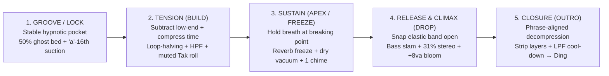

# 44 — EDM & Rave DJ Theory for an Acoustic-First Cyberpan

> **Purpose**: Research & system design blueprint responding to [43-uiux-insights.md](file:///home/sora/repos/cyberpan/docs/43-uiux-insights.md) and building on the empirical DSP findings in [41-social-media-analysis.md](file:///home/sora/repos/cyberpan/docs/41-social-media-analysis.md) and [42-soundboard.html](file:///home/sora/repos/cyberpan/docs/42-soundboard.html).
>
> **Core Thesis**: Turning a handpan performance into an EDM / Rave experience should **not** mean burying the steel instrument under generic white-noise risers and cheesy trance snares. Instead, **80% of rave energy can be generated by the handpan's own acoustic physics** (`Gu` Helmholtz kick, `Tak` rim slap, muted palm-damp 16ths, `"a"-16th` suction, compound-5th overtone bloom, motif loop-halving), reinforced by **20% surgical electronic craft** (tuned sub-sine below the Ding, transparent kick sidechain breathing, resonant filter carving, and reverb-tail freeze).

---

## 1. The 5-Act Rave Energy Arc: Tension → Sustain → Release → Climax → Closure

Traditional EDM prototypes often collapse DJing into a naive 2-state toggle (`build → drop`). Modern techno, melodic house, and rave DJing relies on **five distinct psychoacoustic phases**, each with a specific acoustic mechanism and listener expectation:

### 1.1 Tension (The Elastic Stretch)
Tension is created by **spectral narrowing** and **temporal compression** happening simultaneously:
1. **Low-End Deprivation (Bass Kill / HPF Sweep)**: Gradually sweeping a resonant High-Pass Filter (`28 Hz → 1400 Hz`) removes the grounding sub/Ding weight (`65–250 Hz`). Physically, the listener's body loses its rhythmic floor and leans forward waiting for gravity to return.
2. **Loop-Roll Halving (The Time-Division Trap)**: Instead of overlaying a generic drum-machine snare, rave DJs trap the *existing musical motif* in a shrinking beat loop:
   `2 beats → 1 beat → 1/2 beat (8ths) → 1/4 beat (16ths) → 1/8 beat (32nd stutter)`.
   Because the trapped slice is the **actual handpan phrase**, tightening the loop builds frantic urgency while staying 100% timbrally unified with the instrument!
3. **Handpan-Native Percussive Acceleration**: Layering palm-muted dead strokes (`16%` decay) and rising-pitch shoulder `Tak` slaps (`2.4 kHz → 3.4 kHz`) gives the exact kinetic drive of a rave snare roll—played on steel instead of a canned 909 sample.
4. **3:2 Polymetric Friction**: Introducing dotted-8th (every 3 sixteenths) or triplet accents against the 4/4 pulse destabilizes the listener's downbeat certainty right before release.
5. **Harmonic Suspension**: Holding on `bVI` and `bVII` (never resolving to the tonic Ding `i`) creates intense harmonic yearning for the root to return.

### 1.2 Sustain (The Apex / Breath Hold)
The greatest mistake in naive EDM automation is dropping immediately from maximum noise. The physical euphoria of a drop depends on **contrast across a held threshold**:
1. **Reverb Freeze / Washout**: Right at the apex, send the final high handpan overtone (`+19st` compound fifth) into a cavernous, high-passed stereo hall (`> 340 Hz`) and **hard-mute the dry bus** (`washGate → 0`). The crystalline steel halo hangs frozen in mid-air while all rhythm evaporates.
2. **Pre-Drop Vacuum & Micro-Silence (1–4 Beats)**: Holding silence for 2 to 4 beats lets the crowd collectively inhale. Striking **one naked live handpan note** inside that vacuum feels electric because there is zero competition.
3. **Drop Deception (The Fakeout)**: At the exact expected beat 1, instead of launching full 4-on-floor, switch for 2–4 bars into a **half-time dub/trap pocket** (or 1 beat of stark rim `Tak` silence) before slamming into the real climax. This breaks predictability (directly fixing `#29`'s critique!).

### 1.3 Release (The Kinetic Snap)
Release is a **single phrase-quantized millisecond** (locked to beat 1 or the next beat boundary):
- HPF slams back to `20 Hz` within `16 ms` (full low-end restoration = visceral chest impact).
- Reverb freeze cuts/ducks cleanly so the transient impact hits dry and huge.
- **Bass Slam**: Acoustic `Gu` Helmholtz thump + Ding fundamental (`E3`/`D3`) + tuned sub-sine one octave below (`E1`/`D1`, `41.2 Hz` / `36.7 Hz`) fire together on step `0`, triggering an instant sidechain breath across the sustain wash.

### 1.4 Climax (Evolving Peak Sustain — Never Static!)
Once dropped, a naive prototype loops the same 1-bar beat until it feels boring. Real rave/melodic-house climaxes **evolve across 4- and 8-bar phrases**:
- **Bars 1–2 (Impact Pocket)**: Heavy `Gu` + sub foundation + crisp `"a"-16th` rim pickups + locked motif.
- **Bars 3–4 (Spatial & Register Bloom)**: Stereo width widens from **25% (solo)** to **31% (duet)** (per `#41` Secret 5), upper-register `+8va` singing melody enters with L↔R call-and-response, and polyphony swells from 2 to 4 pitch classes.
- **Bars 5–8 (Polyrhythmic Peak)**: Subtle 3:2 cross-accents and open metallic air shimmer ride over the pocket before preparing either a second tension wave or graceful closure.

### 1.5 Closure (Decompression & Landing)
Most interactive prototypes lack true **closure**—they only offer `PAUSE` or sudden muting. Real DJ closure strips energy **in reverse structural order** aligned to phrase boundaries:
1. **Strip High Activity First**: Remove fast 16th percussive `Tak` & upper `+8va` melody while keeping the warm 50% ghost bed intact.
2. **Spectral Cooling (LPF Descent)**: Gradually roll the master warmth filter down (`2400 Hz → 900 Hz`, mirroring SPRITES Solo's `1134 Hz → 758 Hz` warm outro in `#41` Secret 6).
3. **Temporal Exhale (Rubato Slowdown)**: Ease effective BPM down `-4% to -6%` and lengthen sustain tails (`+40%`).
4. **Tonic Grounding**: Drop the electronic sub cleanly (`Bass Kill`), leaving only the resonant acoustic Ding (`i`) and whisper-soft finger clicks fading into the room halo.

---

## 2. Turning a Handpan Track Into EDM / Rave (Instrument-First Sound Palette)

Inspired by acoustic-techno pioneers (**Sam Maher**, **Hang Massive**, **Kabecao**) and the empirical stem breakdown in [41-social-media-analysis.md](file:///home/sora/repos/cyberpan/docs/41-social-media-analysis.md):

| Rave / EDM Role | Naive Electronic Trope (Avoid) | Instrument-First Handpan Solution (80%) | Minimal Electronic Reinforcement (20%) |
| :--- | :--- | :--- | :--- |
| **Kick / Low Pulse** | Harsh EDM stomp sample | **Helmholtz `Gu` shell hit** (`118 → 64 Hz`) + accented low **Ding** (`E3`/`D3`) | Pure sub-sine reinforcement (`41.2 Hz` / `36.7 Hz`) **phase-locked** to `Gu`/Ding only in Groove & Drop |
| **Snare / Backbeat** | Generic 909 white-noise snare | **Shoulder `Tak`** (`2.4 kHz` crisp rim slap) + **knuckle knock** (`980 Hz`) | Subtle stereo hall send on backbeat `Tak` for club width |
| **Hi-Hat / 16th Drive** | Piercing 10 kHz metallic noise | **Demucs `drums` 3.8 kHz finger-skin clicks** + **palm-muted dead strokes** + **50% ghost-note bed** | Soft off-beat air shaker **only** at Climax peak |
| **Build-Up Riser** | Cheesy raw white-noise sweep | **Motif Loop-Roll Halving** (trapping the live handpan phrase) + **rising `Tak`/muted-slap roll** + **`+19st` compound-5th harmonic shimmer** | Resonant **HPF wash** (`28 → 1400 Hz`) carving out the pan's own body |
| **Pre-Drop Breath** | Abrupt mute button | **Reverb Freeze** holding the handpan's own cathedral overtone tail + 1 naked live strike | Clean dry-bus gate (`washGate`) |
| **Bassline Groove** | Acid saw synth fighting the pan | **1-bar Ding root progression** (`i–VI–VII`, `E3→C3→D3`) + **step-15 `"a"` bass anticipation** | Warm low-passed (`<160 Hz`) sub-bed **carved beneath the Ding** + **sidechain ducking** (`25–55%`) so Ding & sub never turn muddy |

---

## 3. Learned Additive Layers: Architecture & Visual Representation

Addressing Missing Feature #1 from [43-uiux-insights.md](file:///home/sora/repos/cyberpan/docs/43-uiux-insights.md):
> *"When human manually performed notes, the machine needs to learn and hold onto the pattern, consider additive layer based synthesis. Keep the variation but don't lose the layer unless human explicitly drops it. How do you represent a 'learned' component?"*

### 3.1 Why 1€ Forgetting Was Not Enough
In `#19` and `#37`, manually played notes fed a decaying 16-slot memory buffer (`mem.slots`). Even with adaptive half-life, playing a new melody **overwrote or decayed** your earlier bass ostinato! True musical co-creation requires **additive persistence**:
1. **Phrase Segmentation & Pattern Recognition**:
   - Every manual strike (or `#19`-style marquee selection on the PAST wall) writes into a short-term **Live Capture Phrase Buffer** (1-bar / 16-step quantized grid capturing `{ stepMod16, pitch, intervalFromPrev, vel, dur, register }`).
   - After a brief natural phrase pause (~1.6 beats after ≥2 strikes, or immediately on marquee capture), the recognizer classifies the phrase's musical role (`BASS`, `BED`, `MELODY`, or `MOTIF`), extracts its **rhythmic onset mask + pitch contour**, and **crystallizes it into an immutable-until-dropped Learned Layer (`L1`, `L2`, `L3`, ...)**.
2. **Additive Stacking (Zero Unwanted Overwriting)**:
   - Performing a second phrase in another register or rhythmic pocket creates `L2` **on top of** `L1` instead of replacing it.
   - Each layer stays alive **indefinitely** (`decay = 0`) until the user explicitly drops it (`✕` / right-click on its Layer Ribbon).
3. **Living Variation (Never a Dead Looper)**:
   - A raw audio looper feels mechanical. Each Learned Layer stores a **canonical skeleton** (exact rhythmic accents + contour intervals) and renders each future bar through a controlled **Variation Kernel**:
     - **Harmonic Adaptation**: Shifts anchor pitches subtly with the 2.5s `i–VI–VII` harmonic progression while preserving contour shape.
     - **Ornamental Breathing**: Occasionally inserts soft ghost-note `"a"-16th` pickups (`vel ~0.28`) or subtle velocity/microtiming humanization (`±7ms`) so the layer feels performed by a partner who *listened and remembered*.
     - **Density Collision Guard**: If two stacked layers strike the exact same step & pitch, the older layer yields slightly in velocity (`-3 dB`) so clarity stays pristine.

### 3.2 How to Visually Represent a "Learned" Component
A "learned" component must communicate **three things at a glance** without text clutter: *(a) what pattern it learned, (b) that it is actively held + breathing with variation, and (c) which future notes belong to it.*

Our minimalist visual grammar (**Layer Ribbon + Attention Threads**):
1. **Docked Layer Ribbon (`L1`, `L2`, `L3`...)** along the left architectural rail:
   - **Mini 16-Step Geometric Sparkline**: Tiny vertical ticks for onset steps + a continuous polyline tracing the learned pitch contour.
   - **Live Playhead Sweep**: A crisp white dot glides across the ribbon in sync with the bar so you *see* the layer breathing on beat.
   - **Variation Aura**: Faint pulsing micro-dots around mutated notes show the machine is preserving the motif *with living variation*.
   - **Direct Drop Control**: Hover/click to mute/solo; click `✕` (or right-click) to **explicitly drop** the layer—its threads detach and dissolve cleanly.
2. **Luminous Attention Threads**:
   - Thin curved hairline arcs reach from each active Layer Ribbon directly onto the future notes it spawns in the waterfall. You instantly perceive cause-and-effect: *"that learned bass ostinato `L1` is driving those bottom Ding strikes, while `L2` is weaving that high singing line."*

---

## 4. Single-Instrument Multi-Layer Timing Coupling (Bass + Perc + Ghost + Melody)

Addressing Missing Feature #2 from [43-uiux-insights.md](file:///home/sora/repos/cyberpan/docs/43-uiux-insights.md):
> *"Lack of a layered sound. We have a good melody, but missing percussion/bass layer. Such layer can be performed on the same instrument but we need to think about how to couple and coordinate their timing."*

Because a single handpan is played by **two hands on one resonating steel shell**, real virtuosic handpan players never fire all four layers randomly on top of each other. Their timing obeys **Four Coupling Laws**:

1. **Complementary Interlock (The Pocket Law)**:
   - When the **Bass (`Ding`/`Gu`)** anchors downbeats (`0`, `8`, or Tresillo `0, 6, 12`), the **Percussion (`Tak`/`Click`)** locks into the backbeats (`4, 12`) and **`"a"-16th` suction slots (`3, 7, 11, 15`)**.
   - The **Ghost Bed** fills the *unoccupied* 16th-note subdivisions at `30%` velocity (`~10 dB` quieter), automatically dipping on `"e"` (`1, 5, 9, 13`) and yielding whenever a loud Melody accent lands on that exact step!
2. **Harmonic-Register Coupling (The Root Gravity Law)**:
   - Changing or striking a bass root (`Ding`) immediately updates the harmonic gravity (`i / VI / VII`) for both the Ghost Bed and Singing Melody so all four layers move as one unified instrument.
3. **Anticipatory Micro-Phase Coupling (`"a" → ONE`)**:
   - Accented Melody & Bass pickups on step `15` lean `-5 ms` forward into step `0`, while soft Ghost notes sit slightly relaxed (`+2..+6 ms`), creating tactile human swing without dragging BPM.
4. **Selectable Coupling Topologies** (1 unified interaction):
   - **`SUCTION` (`"a"-16th`)**: Steps `3, 7, 11, 15` rim/bass pickups pull forward into every beat (SPRITES / Malte signature).
   - **`TRESILLO` (`3+3+2`)**: Syncopated `0, 6, 12` Ding + interlocking `4, 12` `Tak` + off-beat ghost pocket.
   - **`3:2 FLOW` (Duet Polyrhythm)**: Triplet/dotted-8th melody & ghost shimmer floating across a steady `Gu`/Ding anchor.
   - **`CALL-RESP` (Hocket)**: Melody and Perc/Ghost trade alternating half-bars so every strike has huge breathing room.

---

## 5. Simplified Prototype Matrix (Round `#45` – `#50`)

Following the explicit mandate in [43-uiux-insights.md](file:///home/sora/repos/cyberpan/docs/43-uiux-insights.md) to **focus on 1 core interaction per prototype and keep the visual style radically minimal**:

| Prototype | 1 Core Interaction | Key Insight / Missing Feature Addressed |
| :--- | :--- | :--- |
| **[45-funnel-stage-direct-play.html](file:///home/sora/repos/cyberpan/docs/45-funnel-stage-direct-play.html)** | Clean 3D Funnel Waterfall + Direct Strike (NOW) & Future Note Placement (Funnel Floor) | `#37` 3D effect with **white floor/wall bands removed**; upgraded `#41/#42` acoustic sound & groove; zero side sliders |
| **[46-learned-additive-layers.html](file:///home/sora/repos/cyberpan/docs/46-learned-additive-layers.html)** | Perform or Marquee-Select (`#19`) → Crystallize Persistent **Learned Layers** (Explicit Drop Only) | Solves pattern retention via **additive layer synthesis** + **Layer Ribbon & Attention Thread** visual representation |
| **[47-coupled-perc-bass-layers.html](file:///home/sora/repos/cyberpan/docs/47-coupled-perc-bass-layers.html)** | Single-Instrument 4-Layer Performance (`Gu`/Ding Bass + `Tak`/Click Perc + Ghost Bed + Melody) + Phase Coupling | Solves missing percussion/bass layering & **interlocked timing coordination** on one handpan (`#41/#42` 4-piece band) |
| **[48-organic-dj-curve.html](file:///home/sora/repos/cyberpan/docs/48-organic-dj-curve.html)** | Freehand Emotional Curve Steering (Trajectory-Aware, Non-Predictable, Instrument-First Rave Engine) | Fixes `#29`'s predictability & naive SFX using curve slope/curvature/fakeouts + handpan-native loop-halving & `Tak`/`Gu` rave craft |
| **[49-rave-drop-conductor.html](file:///home/sora/repos/cyberpan/docs/49-rave-drop-conductor.html)** | Single-Axis 5-Act Rave Conductor (`Closure ↔ Groove ↔ Tension/Loop-Halve ↔ Reverb Freeze ↔ Climax Drop`) | Deepens `#30` with true **Tension → Sustain → Release → Climax → Closure** + apex drop-character selection (Rave / Half-Time / Fakeout) |
| **[50-auto-bimanual-cv.html](file:///home/sora/repos/cyberpan/docs/50-auto-bimanual-cv.html)** | Mouse/Keyboard Default → Seamless **"Raise Hand to Enter Bi-Manual CV Mode"** Auto-Switch | Implements `#31` upgrade: zero-clutter mouse/keyboard by default, morphing smoothly into bi-manual spatial control when hands are raised |
